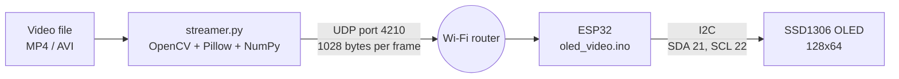
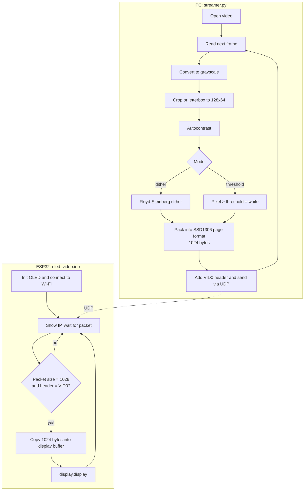

# OLED Video Stream

Stream any video to a 128x64 SSD1306 OLED display over Wi-Fi, using a Python script on your PC and an ESP32 as the receiver.

The PC decodes the video, converts every frame to 1-bit black and white (dithered or thresholded), packs it into the SSD1306 memory format and sends it to the ESP32 as a UDP packet. The ESP32 copies each packet straight into the display buffer and refreshes the screen.

## Features

- Plays MP4/AVI (anything OpenCV can open) on a 0.96" 128x64 OLED
- Two conversion modes: Floyd-Steinberg **dither** or hard **threshold** (adjustable 0-255)
- Two fit modes: **crop** (fills the screen) or **letterbox** (keeps the full frame)
- Adjustable output frame rate
- Simple protocol: one UDP packet per frame, no extra libraries needed on the PC side beyond OpenCV, NumPy and Pillow

## Repository structure

```
oled-animation/
├── README.md
├── streamer.py              # PC: reads video, converts frames, sends over UDP
├── test_send.py             # PC: sends alternating black/white frames to test the display
└── oled_video/
    └── oled_video.ino       # ESP32: receives frames and draws them on the OLED
```

> The Arduino IDE needs the sketch to sit in a folder with the same name (`oled_video/oled_video.ino`).

## Hardware

| Part | Notes |
|------|-------|
| ESP32 dev board | Any ESP32 with Wi-Fi (e.g. ESP32 DevKit V1) |
| SSD1306 OLED, 128x64, I2C | 4-pin module, address `0x3C` |
| Jumper wires | 4 wires |
| USB cable | For power and programming |

## Circuit connections

| OLED pin | ESP32 pin |
|----------|-----------|
| VCC | 3V3 |
| GND | GND |
| SDA | GPIO 21 |
| SCL | GPIO 22 |

```
   ESP32                 SSD1306 OLED (I2C)
 ┌─────────┐            ┌───────────────┐
 │     3V3 ├────────────┤ VCC           │
 │     GND ├────────────┤ GND           │
 │ GPIO 21 ├────────────┤ SDA           │
 │ GPIO 22 ├────────────┤ SCL           │
 └─────────┘            └───────────────┘
```

If the display stays blank, your module may use address `0x3D` instead of `0x3C`. Change it in `display.begin(...)` in the sketch.

## Block diagram



## Flow chart



## Packet format

| Bytes | Content |
|-------|---------|
| 0-3 | ASCII header `VID0` |
| 4-1027 | 1024 bytes of frame data (128 columns x 8 pages, each byte = 8 vertical pixels, LSB on top) |

## Setup

### 1. ESP32

1. Install the Arduino IDE and the ESP32 board package.
2. Install the libraries **Adafruit GFX Library** and **Adafruit SSD1306** from the Library Manager.
3. Open `oled_video/oled_video.ino` and set your Wi-Fi details:
   ```cpp
   const char* WIFI_SSID = "YOUR_WIFI_NAME";
   const char* WIFI_PASSWORD = "YOUR_WIFI_PASSWORD";
   ```
4. Upload the sketch, then open the Serial Monitor at 115200 baud.
5. Note the IP address it prints (it is also shown on the OLED).

### 2. PC

```
pip install opencv-python numpy pillow
```

Your PC and the ESP32 must be on the same network.

## Usage

Test the display first:

```
python test_send.py --ip 192.168.1.50
```

The screen should flash black and white. Then stream a video:

```
python streamer.py video.mp4 --ip 192.168.1.50 --fps 12
```

### Options

| Option | Default | Description |
|--------|---------|-------------|
| `video` | required | Path to the video file |
| `--ip` | required | ESP32 IP address |
| `--fps` | 12 | Output frame rate |
| `--mode` | dither | `dither` or `threshold` |
| `--threshold` | 128 | 0-255 cutoff, only used with `--mode threshold`. Lower = brighter image |
| `--fit` | crop | `crop` fills the screen, `letterbox` keeps the whole frame |

Example with a custom threshold:

```
python streamer.py video.mp4 --ip 192.168.1.50 --fps 12 --mode threshold --threshold 100
```

## Troubleshooting

- **OLED init failed**: check the SDA/SCL wires and the I2C address (`0x3C` or `0x3D`).
- **WiFi FAILED on screen**: check the SSID and password. The ESP32 only supports 2.4 GHz networks.
- **Nothing happens when streaming**: confirm the IP address, and that the PC and ESP32 are on the same network. Some routers block device-to-device traffic (client isolation).
- **Choppy video or dropped frames**: lower `--fps`. UDP does not confirm delivery, so lost packets are simply skipped.
- **Image too dark or too bright**: use `--mode threshold` and adjust `--threshold`, or switch to `--mode dither`.

## 📄 License

Feel free to use, modify, and share this project for personal or educational purposes. Credit is appreciated but not required.

## 🙌 Credits

Created by **GSNCREATIONS**

- YouTube: [@pandustechlab](https://www.youtube.com/@pandustechlab)
- Instagram: [@pandustechlab](https://instagram.com/pandustechlab)
  
Learn like an Engineer, Be like an Engineer!
Keep Creating • Keep Learning • Keep Innovating

